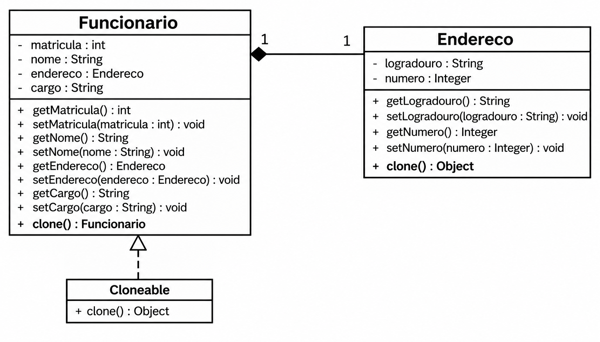

# Padrão de Projeto: Prototype (Sistema de RH)

Projeto em Java exemplificando a aplicação do padrão de criação **Prototype** no contexto de um sistema de Recursos Humanos para a disciplina DCC078-2026.3-A - Aspectos Avançados em Engenharia de Software.

## Diagrama de Classes UML

## Padrão Utilizado

O padrão **Prototype** permite criar novos objetos a partir da clonagem de objetos existentes, evitando a necessidade de instanciá-los novamente. Neste projeto, a classe `Funcionario` implementa a interface `Cloneable` e sobrescreve o método `clone()` para permitir a clonagem de funcionários. A classe `Endereco` também implementa `Cloneable`, possibilitando a clonagem profunda (*deep copy*) do endereço e garantindo que alterações no funcionário clonado não afetem o objeto original.

## Estrutura

- `Funcionario`: representa o funcionário, contendo matrícula, nome, endereço e cargo. Implementa `Cloneable` e sobrescreve o método `clone()` para criar uma cópia independente.
- `Endereco`: representa o endereço do funcionário. Implementa `Cloneable` e permite que o endereço seja clonado separadamente.
- `FuncionarioTest`: realiza os testes automatizados de clonagem, verificando a independência entre o funcionário original e a sua cópia.